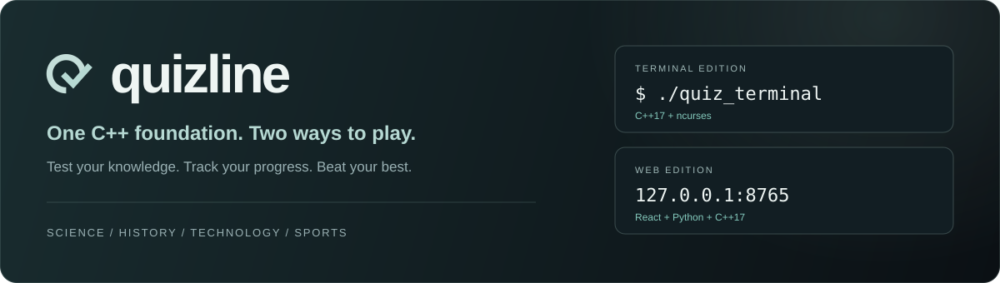
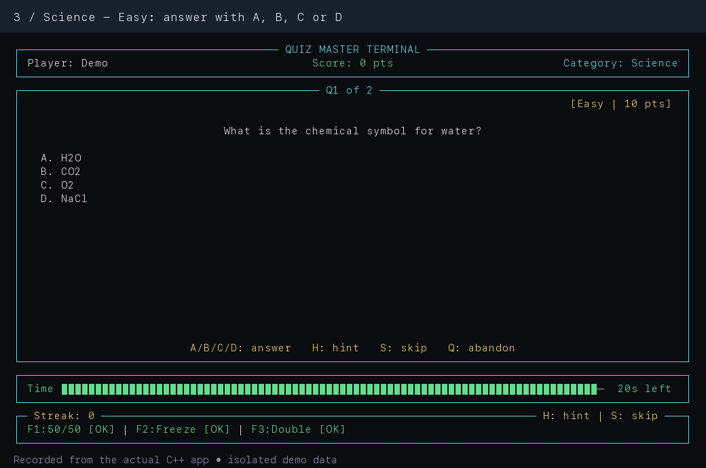
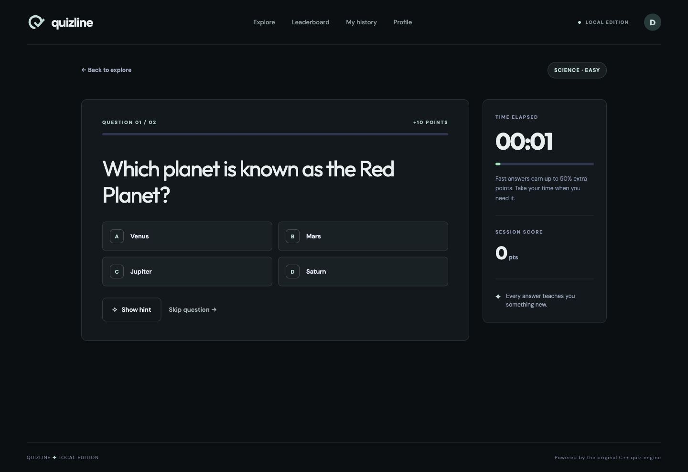
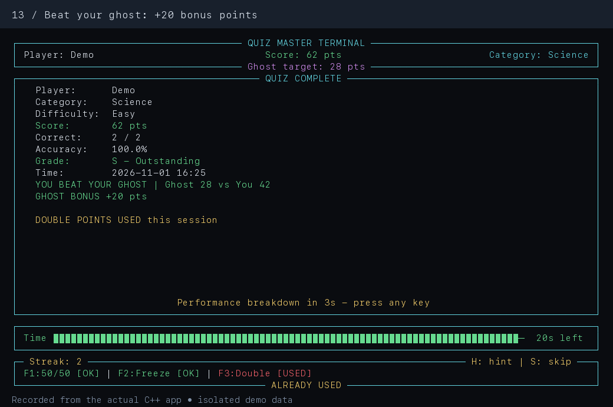
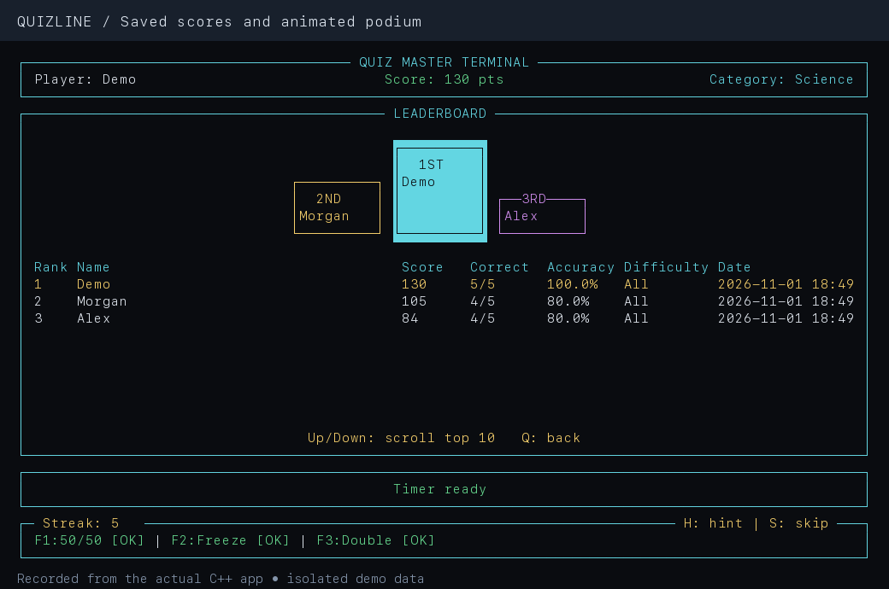
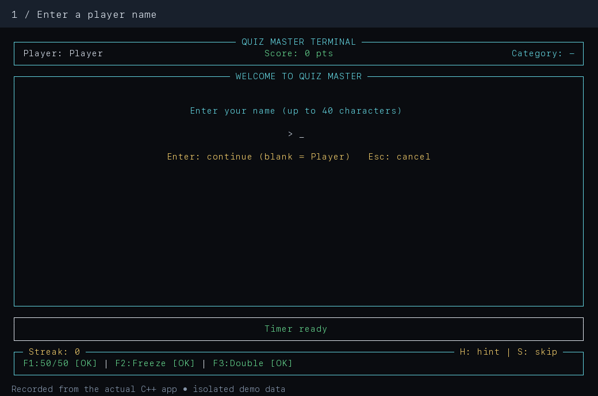
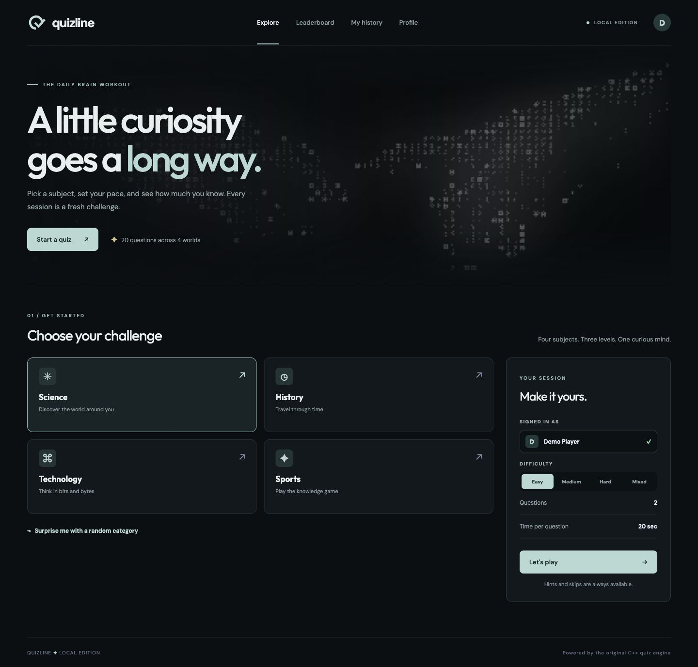
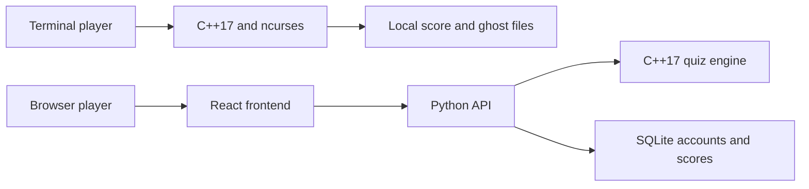

<p align="center">
  
</p>

<p align="center">
  <strong>A C++17 quiz project with a terminal interface and a browser frontend.</strong><br>
  Four subjects. Twenty questions. A personal record worth improving.
</p>

<p align="center">
  <code>C++17</code> &nbsp; <code>ncurses</code> &nbsp; <code>React</code> &nbsp; <code>TypeScript</code> &nbsp; <code>Python</code> &nbsp; <code>SQLite</code>
</p>

<p align="center">
  <a href="#terminal-version">Terminal version</a> &nbsp; / &nbsp;
  <a href="#frontend-version">Frontend version</a> &nbsp; / &nbsp;
  <a href="#how-it-works">Architecture</a> &nbsp; / &nbsp;
  <a href="#documentation">Documentation</a>
</p>

Quizline puts C++ at the center of the quiz experience: question data, answer evaluation, difficulty, and time-based scoring. Choose a keyboard-driven terminal application or a browser interface with accounts and personal history. Each version runs independently.

<table>
  <tr>
    <th width="50%">Terminal version</th>
    <th width="50%">Frontend version</th>
  </tr>
  <tr>
    <td><a href="#terminal-version"></a></td>
    <td><a href="#frontend-version"></a></td>
  </tr>
  <tr>
    <td><strong>C++17 + ncurses</strong><br>Live countdown, power-ups, streaks, and ghost challenges.<br><a href="README_terminal.md">Read the terminal guide</a></td>
    <td><strong>React + Python + C++17</strong><br>Account-owned scores, editable profiles, and session history.<br><a href="README_web.md">Read the frontend guide</a></td>
  </tr>
</table>

## Terminal version

A standalone C++ application with four persistent panels for player information, questions, the countdown, and session status. Everything is controlled from the keyboard.

- **Race the clock.** A live progress bar changes color as time runs out; expiry advances the quiz automatically.
- **Choose your advantage.** Use 50/50, a ten-second Freeze, and Double Points once per session.
- **Build a streak.** Three correct answers in a row trigger the ON FIRE overlay.
- **Challenge your best.** Replay a category and difficulty to compete against your ghost; beating it awards 20 bonus points.
- **Review your progress.** Results, category accuracy charts, an animated podium, and player history make every completed run visible.

### Launch the terminal application

Requires a C++17 compiler, ncurses, and a color terminal at least **80 columns by 24 rows**.

```bash
git clone https://github.com/0xsan7/CPP-project-.git
cd CPP-project-
g++ -std=c++17 -Wall -Werror -o quiz_terminal quiz_terminal.cpp -lncurses
./quiz_terminal
```

Use **Up/Down** and **Enter** in menus, **A–D** to answer, **H** for a hint, **S** to skip, and **F1/F2/F3** for power-ups. **Q** returns or quits. Some macOS keyboards require holding Fn for function keys.

<table>
  <tr><th width="50%">Ghost challenge results</th><th width="50%">Leaderboard and podium</th></tr>
  <tr>
    <td></td>
    <td></td>
  </tr>
</table>

<details>
<summary><strong>Watch the terminal demo</strong> — power-ups, ghost mode, results, and streaks</summary>



The recording follows three actual sessions with temporary demo scores. It is edited into key moments rather than played in real time.

</details>

[Full terminal guide](README_terminal.md): installation on macOS, Linux, and Windows/WSL; all controls; scoring details; saved-file formats; and additional screenshots.

## Frontend version

A browser interface built with React, TypeScript, Vite, and Tailwind CSS. A local Python API calls the C++ quiz engine and stores accounts, sessions, and web scores in SQLite.



- **Explore four subjects.** Choose Science, History, Technology, or Sports, then set a difficulty or play a Mixed session.
- **Play in the browser.** Answer cards, hints, skips, live elapsed time, and immediate feedback support each question.
- **Keep a personal record.** Registered accounts own their scores, history, and profile statistics.
- **Use desktop or mobile.** The layout adapts to narrow screens with stacked settings and bottom navigation.

### Launch the frontend application

From the cloned repository, with a C++17 compiler, Python 3.10+, Node.js 20.19+ in the 20.x line or 22.12+, and npm installed:

```bash
npm ci
python3 server.py
```

Open [http://127.0.0.1:8765](http://127.0.0.1:8765). The server builds the C++ engine and frontend when required. Create a local account and start a quiz. Press Ctrl+C in the server terminal to stop it.

For frontend development, keep the Python server running and run `npm run dev` in a second terminal. Vite prints its development URL and proxies API requests to port 8765.

[Full frontend guide](README_web.md): setup, development workflow, configuration, desktop screenshots, and a mobile preview.

## How it works



| | Terminal | Frontend |
|---|---|---|
| Entry point | `quiz_terminal.cpp` | `server.py` |
| Player identity | Local player name | Registered account |
| Timing | Enforced countdown | Elapsed-time display and scoring |
| Extra features | Power-ups, streaks, ghost mode | Profiles and account-owned history |
| Persistence | `scores.dat`, `ghost.dat`, `terminal_sessions.dat` | `quizline.sqlite3` |
| Requirements | C++17 and ncurses | C++17, Python, Node.js, and npm |

Both editions contain the same twenty-question bank and use the same base scoring and accuracy grades. The web application does not require ncurses; the terminal application does not require Python or Node.js. Power-ups, ghost records, and terminal streaks are not synchronized with web accounts.

### Quiz content and scoring

| Difficulty | Base points | Question time |
|---|---:|---:|
| Easy | 10 | 20 seconds |
| Medium | 20 | 25 seconds |
| Hard | 30 | 30 seconds |

Each category contains two Easy, two Medium, and one Hard question. All (Mixed) plays all five. Correct answers can earn up to 50% extra for speed; wrong answers and skips earn zero.

Grades follow accuracy: **S** at 90%, **A** at 75%, **B** at 60%, **C** at 40%, and **D** below 40%. The terminal enforces question time limits; the browser uses elapsed time for its display and score calculation.

## Documentation

| Guide | What it covers |
|---|---|
| [Terminal guide](README_terminal.md) | Platform setup, controls, power-ups, ghosts, persistence, and screenshots |
| [Frontend guide](README_web.md) | Local hosting, frontend development, account storage, and desktop/mobile screenshots |
| [Media guide](docs/MEDIA.md) | Screenshot sources, demo recording, and asset inventory |
| [Product requirements](PRD.md) | Original scope and acceptance checklist |

The original console interface and the web command adapter remain in `quiz_app.cpp`. Frontend sources live in `web/`, reusable React components in `components/`, and shared styles in `styles/`.

### Validation and scope

The C++ applications build with `-std=c++17 -Wall -Werror`. `npm run build` checks TypeScript and builds the frontend. Terminal checks cover the fifteen original PRD cases, power-ups, ghost comparisons, timer expiry, resizing, and malformed saved records. The browser screenshot session also exercises registration, a completed quiz, and profile persistence.

Runtime checks have been performed on macOS. Linux and Windows/WSL instructions are provided in the terminal guide. The Python server binds to the local computer; public deployment is not configured.

Local scores, account databases, dependencies, and compiled output are excluded from version control. All screenshots use isolated demo data. The login artwork uses remotely hosted media.
