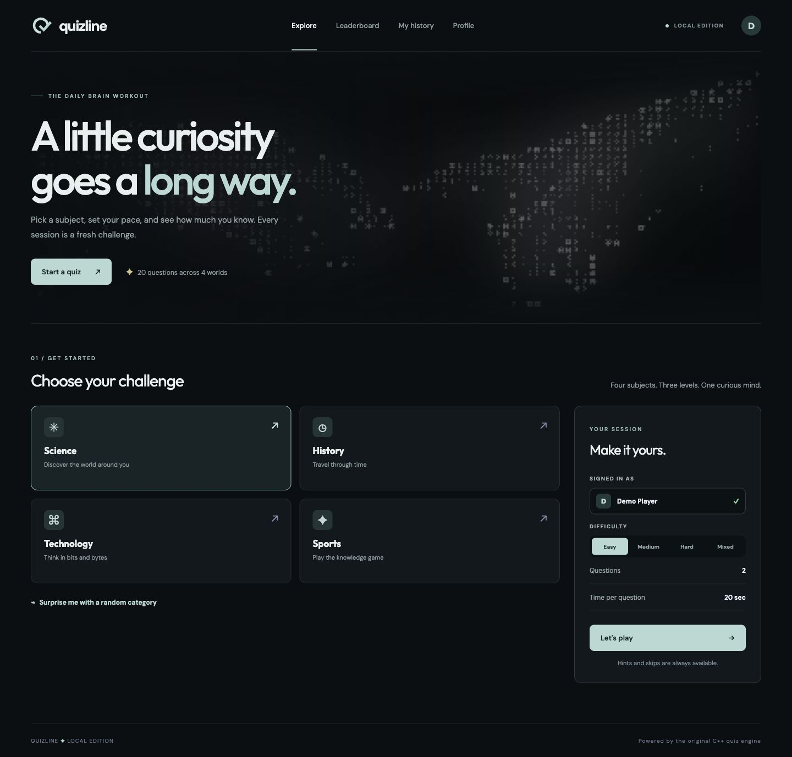
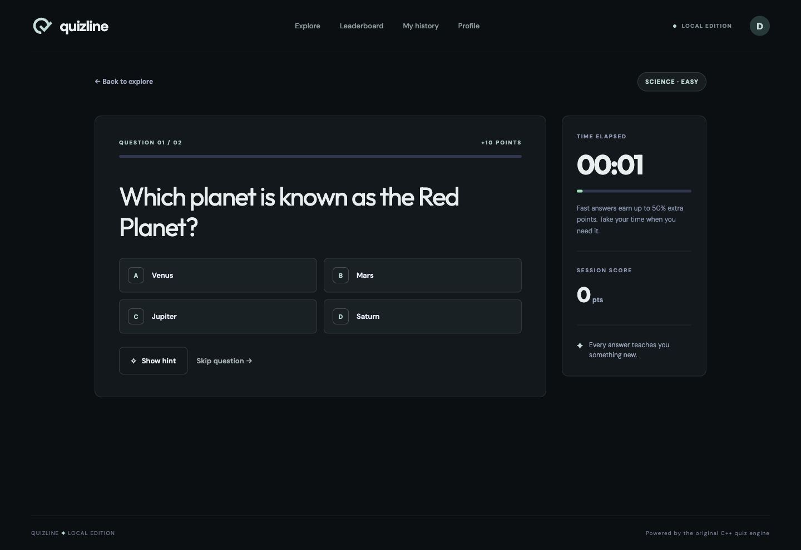
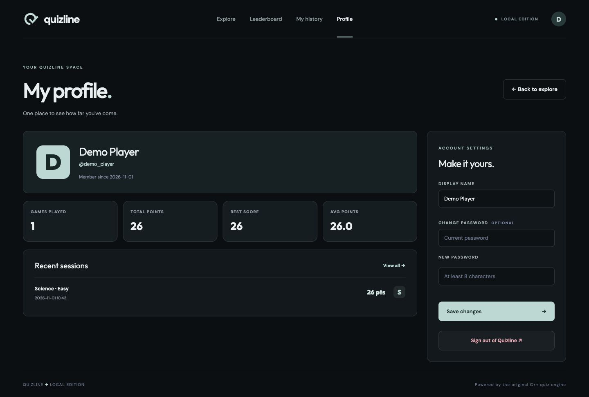
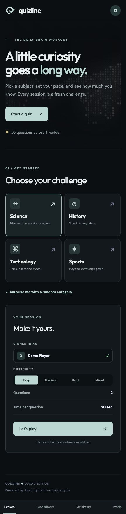

# Quizline Web Edition

The browser interface for Quizline. Return to [the project overview](README.md) or explore [the terminal edition](README_terminal.md).




The browser version provides a styled quiz interface with account registration, sign-in, editable profiles, a leaderboard, and personal session history. The frontend uses React, TypeScript, Vite, Tailwind CSS v4, and a component structure configured for shadcn/ui. Quiz interactions are implemented in `web/app.js`.

The Python server serves the frontend, manages accounts and SQLite persistence, and calls the C++ engine for the question catalog, hints, and answer scoring. Python uses its standard library; a separate package installation with pip is not required.

## Requirements

- A C++17 compiler available as `g++`.
- Python 3.10 or newer.
- Node.js 20.19 or newer in the 20.x line, or Node.js 22.12 or newer.
- npm and a modern browser.

## Install and run

```bash
npm ci
python3 server.py
```

Open [http://127.0.0.1:8765](http://127.0.0.1:8765) in a browser. Create an account or sign in, select a category and difficulty, and start a quiz.

On startup, the server compiles `quiz_app.cpp` into `build/quiz_app` and builds the frontend when its source is newer than the current output. It listens on the local computer only. Press Ctrl+C in the server terminal to stop it.

## Frontend development

Keep the Python server running. In a second terminal:

```bash
npm run dev
```

Open the local URL printed by Vite. Its development server proxies `/api` requests to the Python server on port 8765.

To type-check and build the frontend:

```bash
npm run build
```

The production frontend files are written to `dist/`. Public deployment is not configured; the included Python server is intended for local use.


## Screenshots

### Answering a question



### Player profile and session history



### Mobile layout

The interface adapts to smaller screens, with stacked session settings and bottom navigation.

<p align="center"></p>

## Backend and configuration

| Setting | Default | Purpose |
|---|---|---|
| `QUIZ_PORT` | `8765` | Local HTTP server port |
| `QUIZ_DB` | `quizline.sqlite3` in the repository root | SQLite database path |
| `QUIZ_HTTPS` | Unset | Set to `1` when deployed behind HTTPS to require secure session cookies |

Vite proxies `/api` to `http://127.0.0.1:8765`. If the backend port changes, update the proxy in `vite.config.ts` for frontend development.

The Python API manages registration, sign-in, profiles, quiz sessions, and SQLite persistence. It runs the C++ command adapter in `quiz_app.cpp` to obtain the catalog, hints, and answer scores. Passwords use salted PBKDF2 hashes; signed-in sessions use an HttpOnly cookie.

Web quiz scores belong to the signed-in account. Legacy `scores.dat` entries can appear on the leaderboard, but cannot be attached to an account. The terminal edition's power-ups, streaks, and ghost records are independent of web accounts.

The web timer displays elapsed time and contributes to scoring. The enforced countdown, Freeze power-up, and timeout effects are features of the terminal edition.

The login artwork uses remotely hosted media. It requires network access for the artwork to display. The supplied Python server binds to the local computer and is intended for local use; public deployment is not configured.

## Build validation

```bash
npm run build
g++ -std=c++17 -Wall -Werror -o /tmp/quizline-engine quiz_app.cpp
```

The frontend build checks TypeScript and generates `dist/`. To check the complete flow, create a local demo account, finish a quiz, and confirm its score appears in the profile and history.

## Screenshot provenance

Browser screenshots were captured from the running application at desktop and mobile widths. The displayed account is a temporary demo account in an isolated database. No existing player account data is included. See [the media guide](docs/MEDIA.md) for details.
